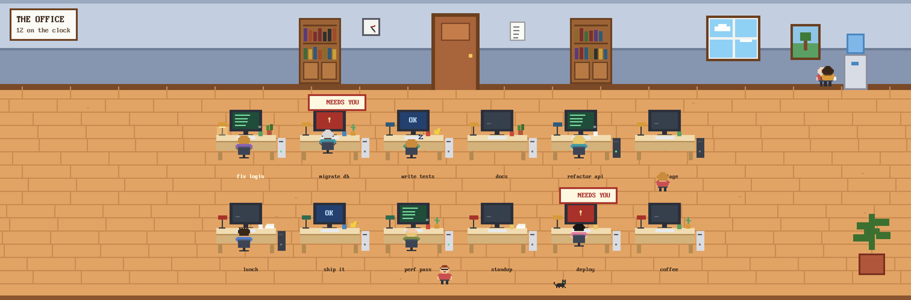

# Office

A pixel-art office for the Herdr app. Every agent is a little office worker at a desk: you can see
who's typing, who's stuck waiting for you, who finished and dozed off, and who wandered off to the
water cooler. The office fills the top of the window, a wood strip runs under it, and your
terminals sit below in wood frames.

## What you see

One fixed look: no system title bar, root background `#8a5530`, theme `graphite` with
`background #1e2230`, `accent #e2a465`, `border #8a5530`. Pixel text is `PxPlus IBM VGA 8x16`
(shipped in `mods/office/fonts/`). Nothing is rounded. Top to bottom:

1. **Office**, weight 1.15. Dragging it moves the window.
   - **Wall**, 150px: upper wall `#c3cfe0` (6px `#9aa9bf` band at the top), wainscot `#8796b0`
     from 80px with a 4px `#6e7c96` rail, 10px `#7a4a28` skirting.
   - **On the wall**, placed from the midline `mid` and the right edge `w`: bookshelves at
     `mid-260` and `mid+190` (70×110 `#9c6436`, two rows of random books, two cupboard doors), a
     clock at `mid-155` (30px, real time: black minute hand, red hour hand), a door at `mid-40`
     (80px, `#a8643a`, opens to a dark doorway while someone arrives), a notice at `mid+90`, a
     window at `w-340` (day `#8fd0f5` with clouds, 17–19h sunset `#f2a65a`, 19–6h night
     `#1d2547` with moon and stars), a framed picture at `w-200`, a water cooler at `w-112`.
   - **Floor** `#e2a465` with `#c98a4f` planks every 22px, seams staggered at random, a few knots.
     A potted plant in the bottom-right corner.
   - **Sign**, top-left: white card, 3px `#6b3f1f` border, `THE OFFICE` (16px) over
     `N on the clock` (12px).
   - **Desks**: slots of 170×190 at scale k, in at least two rows of at least three, centred,
     starting `40k` below the wall. A slot holds a monitor (66×44 `#2b2f3a`, 54×34 screen), a desk
     (`#f0dcb0` top, `#d4b27c` front, legs), keyboard, mug, desk lamp, a PC tower (light or dark)
     and one random piece of clutter (papers, plant, cactus, photo, rubber duck, or nothing). The
     worker's program icon and tab name (16 chars, 12px) sit 130 down. The rest of the slot, 130
     to 190, is the aisle. Spare slots show an empty chair.
   - **Workers**: pixel sprites at `s = round(3k)` screen px per art pixel. Seated (16×20, from
     behind, in a `#3d4454` office chair) or standing (12×17, front or back view, legs swinging).
     Random per agent but stable: hair (8 colours), skin (6 tones), hairstyle (short, long, bun,
     bald, spiky), glasses (30%). The shirt colour follows the agent kind (`claude #d97757`,
     `codex #2f3640`, `gemini #4f7dc9`, `opencode #8a62b8`, `pi #e58fb6`, `grok #5b5b66`, ...),
     otherwise random.
   - **Cat**: a 10×7 sprite in a random coat, roaming the walkways.
2. **Strip**, 28px `#8a5530`: `space / tab` in `#fff1d6`.
3. **Terminals**, weight 1, 10px side padding: the active tab, every pane (a lone one too) in a
   4px `#5c3418` frame (`#e2a465` when focused), 10px apart, with a 26px `#c99a62` header: program
   icon and name, status in capitals on the right (`NEEDS YOU` in `#a8322a` when blocked).

## How it behaves

- **working**: green screen `#1f4d3a`, four `#7ee0a0` code lines growing and shrinking; the worker
  bobs at the keyboard; tower LED green; coffee steam over the mug.
- **blocked**: red screen `#a8322a` with a blinking `!`; the worker jumps; a bobbing `NEEDS YOU`
  sign (`#fff8e1`, 3px `#a8322a` border) floats over the monitor.
- **done**: blue screen `#24406e` reading `OK`; head down, `zZz` cycling.
- **idle / unknown**: dim screen `#36404c`, blinking cursor.
- **Wandering**: each second an idle worker gets up with chance 3.5% (done 1.5%) and goes to the
  water cooler (comes back holding a cup), a bookshelf (a book), the window, the door, the plant,
  a random spot in an aisle, or another seated worker's desk (a `...` chat bubble). They stay 3–11s
  and walk back. Starting work or getting blocked sends them straight back.
- **Walkways**: the corridor along the wall (walker top at `WALL-40`), the aisle behind each row
  (`row top + 128k`), and a lane past each end of the rows. A walk is straight legs between them:
  out of the chair into the aisle, along to the nearer end lane, up or down it, along to the spot.
  Speed 0.11 px/ms (cat 0.07). Workers face the way they walk and face the wall at wall spots.
- **Arrivals**: a new agent's worker appears in the doorway, the door opens for 4s, and they walk
  to their desk.
- **Thoughts**: now and then a seated worker shows `?`, `!`, `♪`, `♥`, `...`, `☼`, `$` or `#`
  for a few seconds.
- **Night** (19–6h): the office dims under `#0b123650` and every desk lamp glows. At 17–19h a warm
  tint.
- Clicking a worker or their desk runs `agent.focus`. Clicking an empty desk opens a tab with the
  first installed agent from `knownAgents()`. Hovering a desk shows a yellow sticky note: tab,
  space, title, status. Desk order follows `agents()` and is passed to `setAgentOrder`.
- **Fit**: tries 2–6 rows, each with `max(3, ceil(n / rows))` columns, with
  `k = min(1, (w-200)/(cols·170), (h-150)/(rows·190+40))`; more rows win only when they make k at
  least 0.08 bigger. k never goes below 0.35.

## Built from

- `layouts/office.json`: a `column` of three blocks: `office-floor` (mod `office`,
  `window_drag`), `office-rail` (mod `office`, props `{role: "rail"}`) and `office-desks`
  (`{tab: "active"}` with a pane frame whose header is mod `office`, props `{role: "pane"}`).
  `preview` points at `layouts/office.svg` for the settings screen.
- `mods/office/art.js`: sprites as rows of palette letters (`sprite(rows, palette, s)` draws one
  `div` per run of a colour), the room, desk clutter, and per-agent looks seeded from a hash of the
  agent's address.
- `mods/office/main.js`: one mod, three roles by `props().role`. A 250ms timer advances walks (one
  straight leg at a time) and, every fourth tick, rolls for new walks, thoughts and the cat. It
  calls `cx.notify()` only when something changed. Every movement is a native
  `.transition("left"/"top")`. Bobbing, legs, blinking and `zZz` are native `loop`/`frames`.
- `props: {demo: true}` on `office-floor` fills it with 12 sample workers in every state, who
  wander four times as often. The preview was taken that way.
- Uses `agents()`, `spaces()`, `panes()`, `knownAgents()`, `run("agent.focus")`, `run("tab.new")`
  and `setAgentOrder`. No network, no `exec`, no files outside its folder.

## Watch out

- `herdr-app check` aborts (a native panic, not a script error) on any mod that uses
  `.transition(...)`, including a five-line test mod, so it can't vouch for this one. Check by
  switching to the layout and looking at `herdr-app status` and `herdr-app shot`.
- Hot reload doesn't always fire through a symlinked mod folder: `layout.switch` away and back.
- Loops and transitions need a stable `.id()`, or they restart every render.
- Walkers don't avoid each other or the cat, and they pass over the name labels in the aisles.
- Sprites use whole pixels (`s = round(3k)`) while desks scale smoothly, so at some sizes workers
  look a little small for their desks.
- `PxPlus IBM VGA 8x16` is CC BY-SA 4.0 (VileR, int10h.org): keep its licence file with it.

## Done when

- `layout.switch {"name":"office"}` shows the office with one worker per running agent, and
  `herdr-app status` reports no errors.
- Starting an agent opens the door, and a worker walks in to a new desk and starts typing.
- When an agent asks for permission its worker jumps under `NEEDS YOU`. When it finishes while
  you're elsewhere, the worker dozes with `zZz`.
- Idle workers get up within a minute or so, walk the aisles and lanes without crossing desks,
  and walk back. They return at once when their agent starts working.
- Clicking a worker focuses that agent's terminal. Hovering a desk shows its sticky note.
